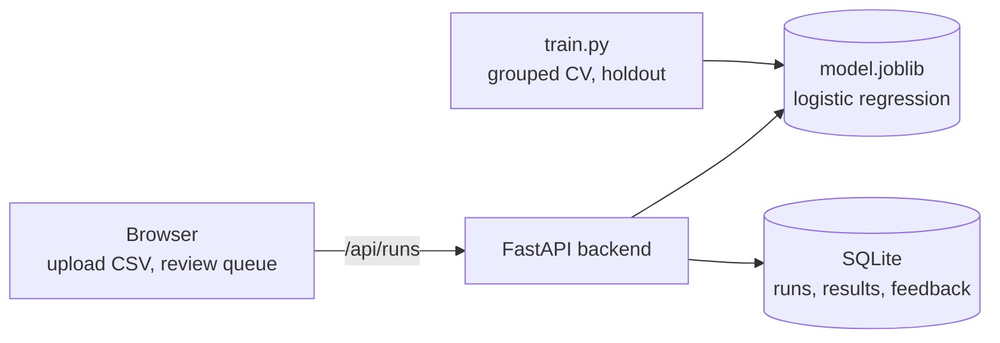
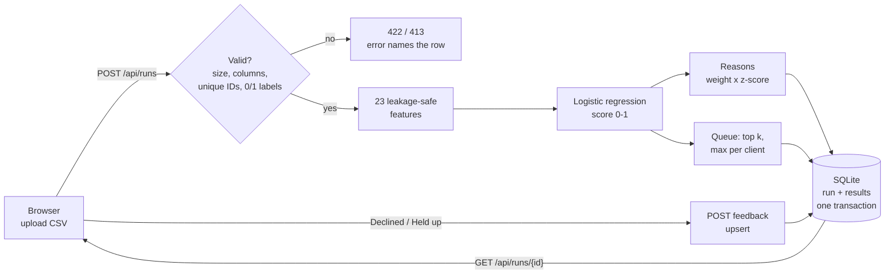
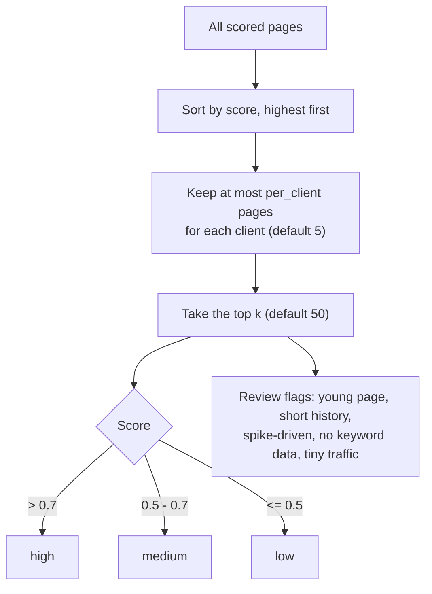
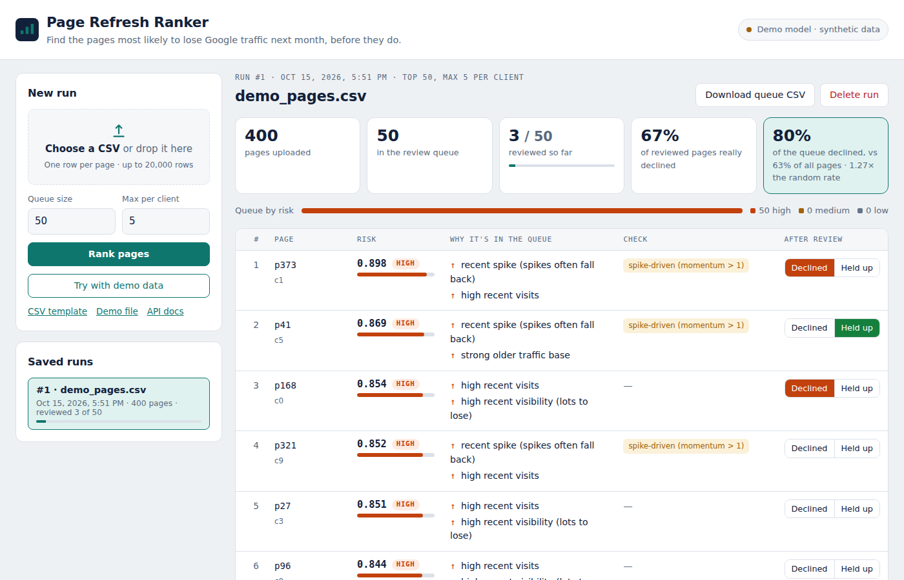

# Page Refresh Ranker

A web app for content teams: **upload your page metrics and get the pages a reviewer should check first**, each with a risk score, two plain-English reasons and flags where a human should look twice. After review you mark what really happened, and the app shows how many queued pages actually declined.

It turns the model from my FlyRank ML internship ([Search-ranking-ml](https://github.com/RodionOm/Search-ranking-ml)) into a full product: website, REST API, database, tests, Docker and CI.



[What the code enforces](#what-the-code-enforces) · [How a request flows](#how-a-request-flows) · [How the queue is built](#how-the-queue-is-built) · [Using the website](#using-the-website) · [API](#api) · [Run it locally](#run-it-locally)

> [!IMPORTANT]
> The screenshot and the demo file use **synthetic pages** with the same columns as the internship data. The real export stays under the programme's data rules and is not in this repository.

## What the code enforces

Each row is a rule, the code that enforces it, and the test that checks it.

| Rule | How the code enforces it | Checked by |
|---|---|---|
| No feature sees the label window | features come only from days 61–90 and 31–60; leaky columns are listed and excluded (`ranker/features.py:25`) | `test_no_leaky_columns`, `test_label_window_does_not_change_features` |
| Serving builds the same 23 columns as training | fixed category lists; one page gives the full column set (`ranker/features.py:39`) | `test_23_features_in_fixed_order`, `test_one_row_gives_the_same_columns` |
| A model trained on other features never loads | the saved model stores its feature list; `load` raises on a mismatch (`ranker/model.py:89`) | `test_load_rejects_other_feature_list` |
| Metrics are honest | `GroupKFold` by client, out-of-fold scores (`ranker/model.py:62`); `train.py --holdout` keeps clients out completely | `test_grouped_cv_reports_metrics` |
| One client cannot fill the queue | sort by score, then at most `per_client` rows per client, then top k (`ranker/review_queue.py:5`) | `test_queue_caps_pages_per_client`, `test_queue_endpoint_caps_clients` |
| Close scores are not tied by rounding | ranking uses full-precision scores (`app/main.py:56`) | `test_ranking_preserves_close_scores` |
| Every reason is readable and points the right way | weight × standardised value, positive contributions only, "above/below training mean" (`ranker/model.py:98`) | `test_every_reason_is_plain_text`, `test_reason_direction_tracks_actual_feature_value` |
| Bad input never reaches the model | Pydantic schema for JSON and CSV rows; errors name the row and field (`ranker/schemas.py`, `app/main.py:95`) | `test_bad_json_is_rejected_with_422`, `test_csv_errors_point_to_the_row` |
| Uploads are bounded and unique | at most 10 MiB and 20,000 rows; duplicate or blank IDs rejected (`app/main.py:31`) | `test_oversize_upload_rejected`, `test_duplicate_ids_rejected_before_database` |
| A run is saved whole or not at all | the run and all its results are written in one transaction; deleting a run cascades (`app/db.py:77`) | `test_upload_creates_a_saved_run`, `test_delete_run_cascades` |
| A reviewer can change an answer | feedback is an upsert on (run, page) (`app/db.py:152`) | `test_feedback_is_upserted_and_summarised` |
| No model means a clear error, not a crash | `get_model` answers 503 with how to fix it (`app/main.py:39`) | `test_missing_model_gives_503` |

## How a request flows



## How the queue is built



The bands are ordered, not calibrated probabilities. Review flags do not change the rank; they tell the reviewer when to look twice.

## Using the website



1. Start the app (see below) and open <http://127.0.0.1:8000>.
2. Upload a CSV with one row per page (drag and drop works), or click **Try with demo data**. The **CSV template** shows the expected columns.
3. Choose the queue size and the maximum pages per client, then **Rank pages**.
4. Review the queue. Each row shows the score and band, the reasons and any review flags.
5. After checking a page, click **Declined** or **Held up**. The run's summary updates. If the CSV has a `declined_observed` column (the holdout and demo files do), the app also shows how many queued pages really declined, against the decline rate of the whole file (lift over a random pick).
6. **Download queue CSV** exports the queue with reasons, flags and the reviewer's answers.

Every run is saved and listed under **Saved runs**; the latest run opens when you come back.

## API

| Method | Path | What it does |
|---|---|---|
| GET | `/api/health` | model loaded? what it was trained on and its metrics |
| POST | `/api/score` | score pages sent as JSON |
| POST | `/api/queue` | top-k queue from pages sent as JSON |
| POST | `/api/runs` | upload a CSV (multipart), score it, save the queue as a run |
| GET | `/api/runs` | list runs with how many pages were reviewed |
| GET | `/api/runs/{id}` | one run: its queue and summary |
| POST | `/api/runs/{id}/feedback` | `{content_id, declined}`; changing an answer updates it |
| DELETE | `/api/runs/{id}` | delete a run with its results and feedback |
| GET | `/api/runs/{id}/queue.csv` | the queue as CSV, with reviewer answers |
| GET | `/api/template.csv` | the expected CSV columns |

Interactive API docs: `/docs`.

## Design decisions

- **No leakage by design.** The label is "impressions fell more than 20% in the last 30 days compared with the 30 days before". The app only accepts the two windows that exist before the prediction point: days 61–90 (`*_older_30d`) and days 31–60 (`*_prev_30d`). A test checks that changing the last 30 days does not change the features.
- **Honest evaluation.** `train.py` reports out-of-fold metrics with `GroupKFold` by client, and `--holdout 0.2` keeps a fifth of the clients out completely. Those pages are written to `data/holdout_pages.csv`, so you can upload them and see the queue for clients the model never saw.
- **Logistic regression on purpose.** In the internship it beat gradient boosting at the top of the list on unseen clients, and its weights give readable reasons (standardised value × coefficient).
- **Fixed feature columns.** Categories come from fixed lists, so one page at serving time produces the same 23 columns as training. The saved model stores its feature list and refuses to load if it does not match.
- **One validation path.** CSV rows go through the same Pydantic schema as JSON requests. Errors name the row and the field.
- **Plain SQL with transactions.** A run and all its results are written in one transaction. Feedback is an upsert. Deleting a run cascades to its results and feedback. A database made by an older version gets its new column added on start instead of failing.
- **Bands are ordered, not calibrated.** In the internship data the "high" band declined about 69% of the time.

## Run it locally

```bash
python -m venv .venv && source .venv/bin/activate      # Windows: .venv\Scripts\activate
pip install -r requirements-dev.txt
python -m pytest -q                                    # tests use synthetic data only

# train on the internship export (not in this repo, see "Data")
python train.py --data path/to/content_refresh_anonymized.csv --holdout 0.2
#   or, without the real data, a demo model:
python train.py --synthetic 3000

uvicorn app.main:app --reload                          # open http://127.0.0.1:8000
```

### Docker

```bash
docker build -t page-refresh-ranker .
docker run --rm -p 8000:8000 page-refresh-ranker
```

If `models/model.joblib` exists, the image uses it. Otherwise the build trains a synthetic demo model, so the image always starts.

### Deploy

The image reads the `PORT` environment variable, so it runs on container hosts such as Render or Google Cloud Run. Two notes:

- A public deployment should use the **synthetic demo model** unless FlyRank agrees to publishing a model trained on their data.
- SQLite lives inside the container. On free hosts the disk is reset on redeploy, so saved runs disappear. For a real deployment, use a managed database.

## Project layout

```
app/main.py             FastAPI routes: JSON API, CSV upload, runs, feedback, static site
app/db.py               SQLite schema and queries (runs, results, feedback)
app/static/             the website: index.html, app.js, style.css, demo_pages.csv
ranker/features.py      23 leakage-safe features, fixed columns, CSV format
ranker/model.py         train, grouped CV, save/load, bands, reason codes
ranker/review_queue.py  top-k queue with a per-client cap, review flags
ranker/schemas.py       request validation (Pydantic)
ranker/synthetic.py     synthetic pages for tests and the demo
train.py                training with grouped CV and an optional client holdout
make_demo.py            regenerates app/static/demo_pages.csv
tests/                  pytest suite
.github/workflows/      CI: tests, Docker build, container health check
```

## Data

The model is trained on the anonymised starter export from the FlyRank AI ML internship. That file is not committed here and stays under the programme's data rules. Tests and the demo file use synthetic data with the same columns.

## Limits

- One 30-day snapshot: no time-based validation yet.
- Mid-traffic pages are ranked close to chance (AUC about 0.57–0.59 in the internship analysis).
- A high score means similar pages declined, not that a refresh will stop the decline.
- No user accounts or authentication.

## Input and ranking safeguards

CSV uploads are limited to 10 MiB and 20,000 rows. Outcome labels must be 0, 1, or blank; duplicate page IDs are rejected before storage. JSON and CSV reject blank IDs. Ranking uses full-precision scores, and reason wording follows the actual feature deviation from the training mean. Tests run on synthetic data and do not establish real-world model accuracy.
